# 卡塞尔专员终端 · CLI 界面设计 v1.0

> 设计日期：2026-11-14
> **修订（2026-11-14 16:03，用户反馈后重设计）**：v1.0 初稿被打回——“没有 claude 那种设计感，而且完全没有龙族的感觉”。本版补了两件事：① §1.1 把 Claude 的设计感拆成 5 条具体手法；② §1.2 把龙族感拆成 5 个具体设定；吉祥物从“小诺玛”（人形，被用户评“好丑”）换成**noya**（小蓝龙，圆滚滚的萌物）；欢迎屏加“卡塞尔学院”标题、S 徽章、今日言灵；思考动词全部换成龙族味（调阅档案、言灵共鸣、解析龙文）；状态行加 S 徽章、空闲文案改成“诺玛待命”。
> **修订（2026-11-14 16:24，noya v3 被打回后重画）**：用户说 v3“完全没有 claude 吉祥物的萌”。诊断：v3 零件太多（角 + 翅膀 + 肚皮 + 尾巴），读起来是“一团蓝上贴了好多东西”；眼睛是深色块，像墨镜。v6 做减法——大圆身子 + 白眼睛（白底 + 黑瞳，卡通式）+ 小微笑 + 头顶一个体蓝色小角包，颜色只用 3 种。v4（深色大眼）、v5（史莱姆式小眼）的迭代图仍在 `mascot/` 里备查。
> **修订（2026-11-14 16:59，noya v6 被打回后重画）**：用户直接发了 Claude 吉祥物原图。看明白了——Claude 的萌不是“大眼睛 + 微笑”，是**横长方形身子 + 4 条短腿 + 两颗小眼睛 + 没嘴**，萌点在轮廓和极致的简单。v7b 照这个语言翻译成龙：横长方形蓝身子、4 条短腿、两颗小方眼睛、没嘴，头顶一个小三角角，颜色只用 2 种。v7 腿太短看不清，v7b 把腿加长到 3 格、身子缩到 6 格。v6（白眼睛圆身子）的迭代图仍在 `mascot/` 里备查。
> **修订（2026-11-14 17:02，noya v7b 被打回后重画）**：用户说 v7b“一看就知道是 claude”——错在抄了 Claude 的形状（长方形 + 腿），只换了颜色。Claude 是参考，不是形状。v8d 只借它的原则（一个扁色、极简脸、独特轮廓、矮胖比例、一眼能认），形状完全换掉：**圆身子 + 两片深蓝小翅膀 + 白眼睛**。圆是鲸鱼的圆，翅膀是龙的标记（深蓝，和身子分得开才看得见），白眼睛让脸亮起来。没嘴、没腿、没角。v8（翅膀在头顶像耳朵）、v8b（翅膀和身子同色合成一团）、v8c（深色方眼睛脸太闷）的迭代图仍在 `mascot/` 里备查。
> **修订（2026-11-14 17:05，欢迎屏改线框分区）**：用户说欢迎屏“好空旷，没有线框分区的那种感觉”。欢迎屏改成线框分区（外框 + 内部分区线，分标题 / 主区 / 会话与入口 / 快捷键四块），并补快捷键与提示填满 20 行对话区。**这是用户明确要的例外**：全 CLI 只有欢迎屏用盒子边框，主聊天、工具行、审批仍按 §1.3 的无框规则。
> **修订（2026-11-14 17:15，终端美化）**：用户说旧版“毫无设计感，就是单纯的黑屏终端，一个丑得要死的蓝色吉祥物，一大堆文字”。按真正的终端美化方案重做：底色改深海军蓝 `#0b1220`（不是纯黑）；三层面板纵深（bg / bg-soft / bg-panel）；标题带放大号粗体 + 底部冰蓝细线；欢迎卡改圆角卡片（填色 + 细边框）；状态行 A 改**实色冰蓝条**（深色文字）；noya缩小成标题带右上角的小徽标（透明底）。线框分区被圆角卡片取代（用户要的是美化，不是线框）。
> **修订（2026-11-14 18:30，noya定稿 v9）**：用户说“你没有 get 到 claude 那个小怪兽的设计语言”，要求调研 Clawd 再做。调研结论：Clawd 是像素橙螃蟹，设计语言是“一个融合轮廓 + 2–3 扁平色 + 两个点当脸 + 一次一个说道具 + 像素网格纪律”，没有官方设计博客。按调研给出 A 独角冰龙 / B 长身龙 / C 大头noya宝 / D 冰晶三角龙四个方向并全部画出，用户先点 C，又说“几个都弄一下给我看看”，看完四只后最终选了 **C 大头noya宝（v9）**。v9 是婴儿图式：头占一半高，头顶一对小蝙蝠翼耳（白尖）是唯一龙标记，圆眼睛（非方形），小身子 + 两只小脚。黑填剪影测试通过（四只剪影一眼能分清）。
> **修订（2026-11-14 18:32，noya v10 定稿）**：用户看完 v9 后说“3 号的头可以只留头加和手和脚吗，就和 claude 的螃蟹一样”——要 Clawd 的结构：脸就是身体，四肢直接长在脸上。v10 删掉 v9 的小身子，保留大头 + 翼耳，加两只小手（两侧横向伸出，像 Clawd 的侧臂）+ 两只小脚。用户在 v9（头 + 小身子）和 v10（头 + 手 + 脚）里选了 **v10**。v9、v8d（圆身子 + 深蓝翅膀 + 白眼睛）的迭代图仍在 `mascot/` 里备查。
> **修订（2026-11-14 19:34，noya v11 + 标题英文 + 桌宠动作扩充）**：用户说“就只有走路太单调了吧，还有把两侧的手去掉，还有多加几个啊”——① 两侧小手删掉，noya只剩大头 + 翼耳 + 眼睛 + 两只脚（v11），更干净；② 光走路太单调，§2.4 扩充动作库（见下）；③ “卡塞尔学院用英文，中文太 low 了”——标题带主标题改英文 **CASSELL COLLEGE**（大号粗体），副标题改 **COMMISSIONER TERMINAL**，全英文标题像奢侈品 logo，比中文标题高级。
> **修订（2026-11-14 19:47，用户纠正：是 Codex CLI，不是 Code CLI）**：用户说“Codex cli，我发错了”——上面那条“Code CLI”写错了，真正参照的是 **OpenAI 的 Codex CLI**（用户平时用得最多的那个），Claude 仍为辅、互相借鉴。Codex 和 Claude Code 的按键不一样，**按键跟着改**：Codex 是 **Shift+Tab 切模式**（Plan/Pair/Execute 轮换）、**Tab 排队**（工作时按 Tab 把下一条指令排进下一轮，叫 Steer 模式）、权限用 **`/permissions`** 命令改（Ask / Approve for me / Full Access / Read Only）。所以这里也改成：**Shift+Tab 切 NORMA/EVA**（换工位）、**Tab 排队**（工作时）/ 接受幽灵补全（空闲时）、权限用 `/permissions`、`/plan` 进计划模式、Esc 中断、Esc×2 改上一条。上面 19:45 那条写的“Tab 切模式、Shift+Tab 切权限”作废。
> **修订（2026-11-14 21:24，4 个优化全做，包括功能）**：用户问“还有更多优化方案吗”，助理提了 4 个（noya状态灯、审批放行、渲染防闪、自动压缩）；用户先说“只让设计前端，先不用管功能”，随后点“4 个全做，包括功能”——**4 个全做，功能逻辑也一起设计**（见 §12）。范围以这条为准：前端 + 功能都写进本文。
> **修订（2026-11-15，noya定位补进 §2.0）**：用户问：桌面端已经有 EVA 和诺玛，noya又是什么定位、该怎么跟用户解释。补 §2.0 钉死：noya不是第三个专员 / 第三种模式，是学院吉祥物 + 顶栏桌宠，不干活、不说话，只陪伴 + 显示状态；诺玛 / EVA 负责干活和说话。noya v11 本身不动（新创意只是给同一只noya加动作 / 状态 / 节日衣服，见创意页）。
> **修订（2026-11-15，noya改名 + 设定补齐）**：用户定名 noya（旧名“龙宝”太土，废弃）。noya是诺玛研究的终端版数字生命（不是实体）：龙的基因数据 + 诺玛 AI 代码融合出的数字混血种，身体是信息、血是龙的基因数据、脑是诺玛；是诺玛和装备部造的、类似绘梨衣的底牌性武器；对人类友善，对龙类和坏人不友善，听从执行部专员，学生们叫它吉祥物。心智是个小孩（不成熟、爱玩、坐不住），但小孩不等于弱——它是底牌，力量是真的。在卡塞尔所有学生的电脑里闲逛，把全校的电脑都当成自己的领地（龙的领地意识，领地是数字的）。完整设定见 `lore/noya-设定.md`。全文“龙宝”统一改成 noya（资产文件名 dragon-v11-* 不动）。
> 前置文档：`docs/claude-code-cli-teardown.md`（§5 已定技术选型 Rust + Ratatui、三区布局、对照方案——本文是它的**界面落地版**，不重复讲选型，只定界面长什么样、每个屏幕怎么画、每个状态怎么写）。
> 适用：卡塞尔 CLI v1（M1–M3）。吉祥物与效果图见本文 §2 与附录；效果图 PNG 在 `cli-design/mockups/`。

---

## 1. 设计总纲：两颗星——Claude 的设计感，卡塞尔的魂

本文 v1.0 的初稿被用户打回，理由两句，原话照录：

> “整体设计也没有 claude 那种设计感，而且完全没有龙族的感觉。”

所以这一版先把两件事钉死，再谈屏幕。**设计感不是“好看”，是具体的手法；龙族感不是“贴个龙”，是具体的设定。** 下面两节就是这两件事的清单——每一项都能在验收时打勾，缺一项就是没做到。

### 1.1 Claude 的设计感从哪来（5 条具体手法，不是感觉）

Claude Code 好看，不是因为它用了什么高级技术，而是因为它在 5 件事上极度克制、极度一致。抄这 5 条，错不了：

1. **克制到只剩一个强调色**：全界面一个彩色（Claude 是橙，我们是 EVA 蓝）+ 灰阶。没有第二种彩色抢戏，没有装饰，没有渐变。高级感来自“少”，不是“多”。
2. **节奏固定，三区永不换位**：对话区 / 输入框 / 状态栏，位置永远不变；每一回合都有明确的开始（spinner + 动词）、过程（工具行依次出现）、结束（过去时总结 + 用时/token）。用户不用重新找东西，节奏本身就是设计。
3. **信任感来自“看得见”**：工具调用永远看得见（一行），结果写成人话，失败给红色短标签 + 完整信息可查。藏起来的是细节，不是事实。用户敢把文件交给它，是因为每一步都看得见。
4. **性格藏在细节里，不抢主流程**：像素吉祥物只在启动时出现一次；spinner 动词每回合换一个，但字号、颜色、位置永远不变。性格是调味，不是主菜。
5. **信息分层，默认只给一行**：默认只给一行摘要，展开才给详情（转录视图、折叠的工具行）。长会话不靠删内容，靠折叠。界面永远不挤。

**反面**：颜色超过 2 种、分区用盒子框起来、状态行塞满 10 个字段、工具调用藏起来、思考指示用三个跳动圆点——这 5 件事做任意一件，设计感就没了。

### 1.2 龙族感从哪来（5 个具体设定，不是贴图）

龙族感不是“画条龙”，是卡塞尔学院的世界观。抄这 5 个设定，每一个都是原作里真实存在的东西（来源：`lore/龙族知识库.md`，不要编）：

1. **学院 framing**：这不是一个通用助手，是**卡塞尔学院的专员终端**。欢迎屏的标题就是英文大号粗体“CASSELL COLLEGE”（用户 2026-11-14 亲口定：中文标题太 low，要英文），用户是学院唯一的 S 级学生路明非（编号 S2017-0117）。每一次打开，都是一次“回到学院”。
2. **S 印章（血统徽章）**：S 级是用户的身份。状态行里一个紧凑的 `S` 徽章（衬线 S + 发丝圆环的终端版），欢迎屏里 S2017-0117 编号常驻。不用解释，看到 S 就知道是谁。
3. **今日言灵（Words of Power）**：言灵是龙族血裔的超能力，用龙文吟唱、在“领域”内改写规则。欢迎屏每天轮换一条真实言灵（如“时间零 (84) · 昂热 · 延缓时间”、“君焰 (89) · 楚子航 · 火焰爆炸”），带序号、使用者、效果。**只用知识库里核实过的言灵，不编。**
4. **noya（吉祥物）**：一条圆滚滚的小蓝龙，卡塞尔的吉祥物。不是鲸鱼的复制品，是龙族自己的萌物（见 §2）。
5. **诺玛的口吻**：思考时的动词不用通用词（“正在想想看”），用学院的词——调阅档案、言灵共鸣、解析龙文、校准炼金矩阵（见 §5.3）。诺玛是学院中枢 AI，她说话就该有学院的味道。

**反面**：把龙族感做成“到处贴龙的图片”、用金色（铁律禁用）、编造不存在的言灵、把学院写成通用公司的“欢迎使用本产品”——这 4 件事做任意一件，龙族感就假了。

### 1.3 桌面端铁律在终端里的翻译

| 桌面端铁律 | CLI 翻译 |
|---|---|
| 现代极简高级 | 一个强调色 + 灰阶；三区固定节奏；留白靠空行，不靠装饰 |
| 不要线条、不要线框感 | **分区不用盒子边框**。区与区之间只用一条 `─` 分隔线；面板、卡片、对话框一律无框，靠背景色阶与间距分层。**例外：欢迎卡是一张圆角卡片（用户 2026-11-14 要美化，见 §5 S1）** |
| 要有纵深和层次 | 背景三档（底色 / 柔和底 / 面板底）+ 文字四档（正文 / 次要 / 暗淡 / 强调），不用线框也能分出层 |
| 不要金色 | 全站禁用金色 / 黄色。强调色只用 **EVA 蓝**（NORMA 态用白色） |
| 不要照片、不要位图 | 吉祥物是**字符像素画**（盲文 / 半方块拼出来的点阵），不是图片文件；界面里不出现任何位图 |
| 一切切换平滑过渡 | 终端里没有 CSS 过渡，用**节奏**代替：工具行逐行出现（间隔 60–80ms）、开场三帧 1 秒、模式切换插一行分隔提示。**不许整屏突然闪一下**；刷新只重绘变化的行（Ratatui 差分渲染） |
| 全站灵动、有生命感 | 吉祥物只在开场时“活”（眨眼、睁眼），干活时只留眼睛做 spinner；思考动词每回合换一个；状态行永远有“正在发生的事” |
| 字体与细节 | 继承终端字体（不自带）；流式光标是蓝色圆点 `●`（不是竖条 `▍`）；用户消息无气泡、无边框，只用 `❯` 前缀 + 颜色区分 |
| 不许假数据 | 没配 Key 的服务商不显示模型、不显示假连接、不显示假时间；空状态就是空状态，写清楚“还没有配置模型，按 /provider 开始” |

**一句话验收**：打开第一眼，觉得这是一个活的产品在呼吸，而不是一个能跑命令的黑框。

---

## 2. 吉祥物：noya（小蓝龙）

### 2.0 定位：noya是什么、不是什么

**noya不是第三个专员，也不是第三种模式。** NORMA / EVA 是同一个智能中枢的两种性格（办公 / 工程），负责干活和说话；noya不干活、不说话、不做决定、不参与模式切换。模式指示由状态行的 `◉` 球承担（NORMA 白 / EVA 蓝），见 §2.2。

**noya是卡塞尔学院的吉祥物——一个住在终端顶栏里的小龙数字生命。** 它只做两件事：① 陪着用户；② 把当前状态一眼告诉用户（想 / 干 / 成 / 错 / 睡，见 §2.4 的事件反应）。它出现在哪里、做什么动作，都不改变 NORMA / EVA 的工作。
**noya不是实体，是诺玛研究的终端版数字生命。** 它的身体是信息，血是龙的基因数据，脑是诺玛的 AI——一个数字混血种（龙数据 + AI 的混合体）。它是诺玛和装备部造的、类似绘梨衣的底牌性武器：对人类友善，对龙类和坏人不友善，听从执行部专员。心智是个小孩（不成熟、爱玩、坐不住），但小孩不等于弱——它是底牌，力量是真的。它在卡塞尔所有学生的电脑里闲逛，把全校的电脑都当成自己的领地。完整设定见 `lore/noya-设定.md`。

打个比方：诺玛和 EVA 是你的两个同事，noya是办公室里养的那只猫。同事帮你干活，猫只负责可爱和陪伴，互不抢活。

龙族世界观里也说得通：卡塞尔是屠龙学院，学院养一条小龙当吉祥物再合适不过——noya就是学院的那条小龙，只不过它没有实体，活在全校学生的电脑里，把所有人的电脑都当成自己的领地。

**给用户的一句话**：“诺玛和 EVA 是帮你干活的专员，noya是住在终端里陪你的小龙，它不说话，就是告诉你现在干到哪了。它是诺玛家的小龙，一个数字生命，对你友善，对龙和坏人不友善。”

### 2.1 定稿

桌面端的球不动。CLI 的吉祥物是一条**圆滚滚的小蓝龙**，名叫**noya**——卡塞尔学院的吉祥物，龙族自己的萌物。

用户原话：“我要的萌物，就和蓝色鲸鱼一样的那种萌物。”——要的是鲸鱼那种**圆、简单、蓝、萌**的感觉，不是鲸鱼本身。所以noya抄的是鲸鱼的“圆和简单”，不是鲸鱼的长相。

**v11 定稿（2026-11-14，v10 去掉两侧小手）**：用户说“把两侧的手去掉”——手让轮廓变乱，去掉后更干净。v11 是：**一个大圆头（整个就是身体），头顶一对小蝙蝠翼耳（白尖）是唯一龙标记，两颗圆眼睛（3×2，非方形），底下两只小脚**。没身子、没手、没嘴、没鼻、没角、没尾巴。萌点在比例（头大、眼睛大而低）+ 一个融合的轮廓。翼耳是唯一破口：黑填剪影里翼耳是头顶唯一的凸起，删掉翼耳就变成普通宝宝团。v10（带小手）、v9（头 + 小身子）、A 独角冰龙（v9a）、B 长身龙（v9b）、D 冰晶三角龙（v9d）的迭代图仍在 `mascot/` 里备查。

- **长相**：一个大圆头（整个就是身体）+ 头顶一对小蝙蝠翼耳（白尖）+ 两颗圆眼睛（深蓝，3×2）+ 底下两只小脚，没身子、没手、没嘴、没鼻、没角、没尾巴。
- **画法**：字符像素画，26×18 格，颜色只用 3 种（体蓝 #60a5fa / 深蓝 #0F172A（眼睛）/ 白 #FFFFFF（翼耳尖）），继承终端前景色逻辑。实现时用半方块（`▀▄█`）或盲文点阵渲染，约 8–12 行高。
- **两种表情**：睁眼（默认）与闭眼（开场第一帧 + 眨眼帧）。闭眼时眼睛上行消失、下行变成两条细深色线——眨眼就是眼睛出现 / 消失，400ms 一帧，干净利落。

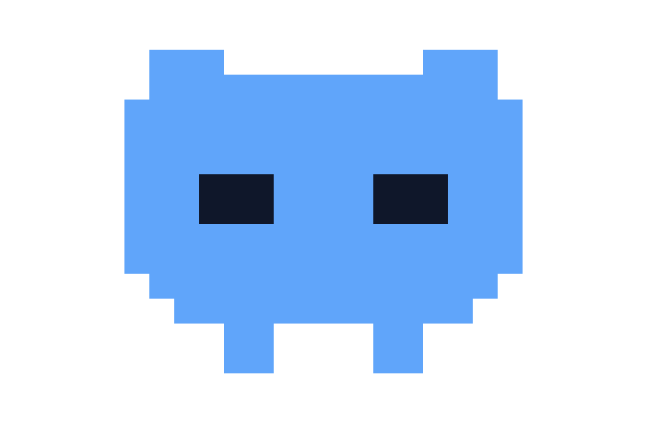

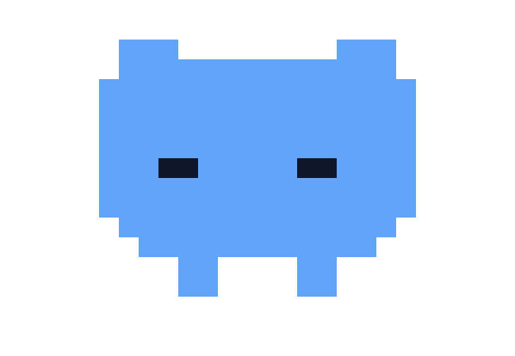

### 2.2 像素稿（实现直接用这张表）

```
. = 透明（终端底色）  B = 体蓝 #60a5fa  D = 深蓝 #0F172A（眼睛）
W = 白 #FFFFFF（翼耳尖）

..........................
.......W..........W.......
......BBB........BBB......
......BBBBBBBBBBBBBB......
.....BBBBBBBBBBBBBBBB.....
.....BBBBBBBBBBBBBBBB.....
.....BBBBBBBBBBBBBBBB.....
.....BBBDDDBBBBDDDBBB.....
.....BBBDDDBBBBDDDBBB.....
.....BBBBBBBBBBBBBBBB.....
.....BBBBBBBBBBBBBBBB.....
......BBBBBBBBBBBBBB......
.......BBBBBBBBBBBB.......
.........BB....BB.........
.........BB....BB.........
..........................
..........................
..........................
```

- **闭眼帧**：第 8 行（行号从 1）改成全体蓝，第 9 行的眼睛改成两条细深色线（`BBBDDBBBBBDDBBBB`）。其余不变。
- **球的颜色跟模式走**：noya身边不漂球了——noya本身就是吉祥物。模式指示改由状态行的 `◉` 球承担（NORMA 白 / EVA 蓝），见 §7。
- **Windows 实测要求**：盲文 / 半方块在某些字体下宽度不一致，画之前先做宽度自检，画坏了回退到字符画（`█` 块）。上线前必须在 Windows Terminal + ConPTY 实测。

### 2.3 noya出现在哪里（三种形态）

| 形态 | 出现位置 | 频率 |
|---|---|---|
| **桌宠** | 常驻顶层标题带，来回闲逛、做动作（见 §2.4） | 常驻，每时每刻都在 |
| **状态行小标记** | 状态行 A 最左侧一个单字符 `◉`（NORMA 白 / EVA 蓝）+ 状态小字 | 常驻，每时每刻都在 |
| **思考中的眼睛** | 状态行 C 的 spinner 用noya的眼睛做：睁眼 / 闭眼 400ms 交替 | 思考 / 工作时 |

**克制原则**：noya是桌宠，不是弹窗——它只在顶层活动（见 §2.4），永远不进对话区、不遮标题、不抢输入焦点。干活时对话区是主角，noya在顶层自己玩，不打扰。

### 2.4 桌宠：noya常驻顶层，来回闲逛

用户 2026-11-14 18:35 要求：noya不要只当一个静态小徽标，要像桌宠一样**常驻在顶层（标题带），来回闲逛、做动作**。顶层就是它的活动空间。

**活动空间（跑道）**：
- 顶层 = 标题带（欢迎屏 / 主聊天 / 审批屏共用同一条标题带，noya在哪屏都在）。
- 跑道是标题带右侧的空地：左端在标题文字右缘之后（约第 24 列），右端在屏幕右缘之前（约第 66 列，留 2 列边距）。noya宽约 13 列，在跑道上来回走。
- noya不进对话区、不遮标题、不遮状态行。只在顶层活动。

**动作库**（都在 `mascot/` 里，26×18 格，3 色；v11 去掉了两侧小手，帧表按 v11 画）：
- **行走**（已有；多帧版 `dragon-v11-mf-walk-R-A/B/C/D`、`dragon-v11-mf-walk-L-A/B/C/D`，左右各 4 帧，脚本 `render_dragon_v11_multiframe.py`，拼图 `contact-sheet-multiframe.png`）：A 一脚前抬 → B 双脚着地 → C 另一脚前抬 → D 双脚着地 + 全身下沉 1 格（起伏低点，D→A 接回）；眼睛往行走方向偏 1 格。左右是镜像。单帧旧版 `walk-R-A/B`、`walk-L-A/B` 保留。
- **张望**（已有；多帧版 `dragon-v11-mf-look-left-1/2/3`、`dragon-v11-mf-look-right-1/2/3`，每边 3 帧）：1 眼睛居中、2 半偏（靠张望方向一侧的那只眼先移 1 格）、3 全偏（两只眼都移 1 格）。停下来时左右看看。单帧旧版 `look-left` / `look-right` 保留。
- **眨眼**（已有）：复用闭眼帧（`dragon-v11-closed.png`），150ms。
- **跳**（已有；多帧版 `dragon-v11-mf-jump-1/2/3`）：1 蹲下（身体下沉 1 格、脚张开）、2 最高点（整只上移 2 格、脚收起）、3 落地（压扁 1 格、脚着地张开）。300ms 上 + 300ms 下。
- **睡觉**（新增；多帧版 `dragon-v11-mf-sleep-1/2/3/4`）：眼睛闭上（闭眼帧），头顶飘出一个白色小 `Z`（3×3，逐帧往上飘），sleep-3/4 身体下沉 1 格，sleep-4 两侧胀出 1 格（呼吸起伏）。睡 5–10 秒，醒来时跳一下伸懒腰。用户长时间没输入（> 30 秒）时更容易触发——像它也在等你。单帧旧版 `sleep-1/2` 保留。
- **打滚**（新增；多帧版 `dragon-v11-mf-roll-1/2/3/4`）：缩成一团球（翼耳收进轮廓里，变成一个纯圆），球上一个白色旋转标记顺时针顶→右→底→左，4→1 接回。快速往左 / 右滚 5–8 列（每帧 2 列，比走路快一倍），滚到头弹一下再变回站立。最能体现“圆”的动作。单帧旧版 `roll-ball` 保留。
- **躲猫猫**（新增；多帧版 `dragon-v11-mf-peek-1/2/3`）：1 藏（沉到标题带底边以下，只剩两只翼耳尖露在外面，2 格高）、2 半露（下沉 4 格，眼睛刚露）、3 全露（睁眼帧）。停 1 秒后突然弹出来，眼睛睁大。像在跟你玩。单帧旧版 `peek-hide` 保留。
- **跳舞**（新增；多帧版 `dragon-v11-mf-dance-1/2/3/4`）：1 左倾、2 居中左脚点地、3 右倾、4 居中右脚点地。左右摇摆 2–3 秒，像在打节拍。思考时间长（> 10 秒）时触发——它在陪你等结果。单帧旧版 `dance-L/R` 保留。
- **接雪花**（新增；多帧版 `dragon-v11-mf-snow-1/2/3/4`）：一片雪花（白色 2×2 小点）从顶上飘下来（高→中→头顶→落头顶），noya抬头盯着它（眼睛上移 1 格），雪花落到头顶时它开心地跳一下（开心闭眼），雪花消失。卡塞尔的雪，应景。每 10 分钟最多一次（用户 2026-11-14 亲口定：1 小时太慢，用户可能看不到）。单帧旧版 `snow-1/2` 保留。
- **吃东西**（新增；多帧版 `dragon-v11-mf-eat-1/2/3/4`）：面前出现一小块点心（白色 2×2），noya低头啄 3 下（身体上下 1 格交替），点心逐口变小消失（1 出现 → 2 剩 1 格 → 3 碎屑 → 4 吃完满足闭眼），掉两粒碎屑。饭点（12:00 / 18:00 前后）更容易触发。单帧旧版 `eat-1/2/3` 保留。

**事件反应（状态灯，新增，已画好 `react-celebrate/dizzy/yawn`）**：noya不只是自己玩，还会对任务有反应，变成一眼能看的状态指示——闲逛状态机让路，事件优先：
- **成功庆祝**（`react-celebrate`）：任务做完了，跳一下庆祝（闭眼 + 整只上跳 1 格 + 头顶飘两个白色小亮点），约 1 秒。用户一眼就知道“成了”。
- **出错晕**（`react-dizzy`）：任务出错了，眼睛变 × ×（两只眼睛各画成一个小叉），停 2 秒。用户一眼就知道“出事了”。
- **打哈欠**（`react-yawn`）：思考超过 30 秒，眼睛半闭成一条缝 + 身体往下塌 1 格，打个哈欠。只打一次，接着该睡觉睡觉（转睡觉动作）。

**行为（状态机）**：
- 走 → 停 → 闲逛动作 → 走。走一段（5–15 列）就停下来 1–3 秒，停的时候从动作库里随机挑一个做（眨眼、张望、跳、睡觉、打滚、躲猫猫、跳舞、接雪花、吃东西）。
- 走到跑道尽头必须掉头（眼睛先转向另一边，停 300ms，再往回走）。
- **事件优先**：任务成功 / 出错 / 思考超 30 秒时，立刻打断闲逛、做对应的反应帧（庆祝 / 晕 / 打哈欠），做完再回到闲逛。反应帧期间不随机做别的动作。
- 时序：走路每帧 200ms，每帧往前 1 列；眨眼 150ms 闭 + 立即睁；张望每边 400–800ms；跳 300ms 上 + 300ms 下；睡觉 5–10 秒；打滚每帧 2 列；躲猫猫藏 1 秒 + 弹出；跳舞 2–3 秒；接雪花全程约 3 秒；吃东西约 2 秒；庆祝约 1 秒；晕 2 秒；打哈欠约 1 秒。
- 随机但克制：用固定种子伪随机，动作间隔不小于 1 秒，不连续做同一个动作、不连续掉头；睡觉和接雪花有冷却（睡觉 2 分钟一次，接雪花 10 分钟一次）。noya是陪伴，不是捣乱。

**约束**：
- 只在顶层，不进对话区；不遮标题、状态行、输入框。
- 走路时不抢输入焦点；用户打字时noya照常走（它是桌宠，不是弹窗）。
- `--plain` 纯文本模式不画noya（管道 / 脚本场景）。
- 性能：每帧只重绘noya所在的 13×5 区域，不整屏刷新；走路 200ms 一帧，CPU 占用忽略不计。

**实现要点**：
- noya用盲文点阵渲染（13 列 × 约 5 行），帧表直接用 §2.2 的像素稿 + 本节的行走 / 张望帧。
- 位置状态：`pet_x`（列）、`pet_dir`（左 / 右）、`pet_state`（走 / 停 / 张望 / 跳 / 眨眼）、`pet_frame`（A / B）。每 200ms tick 更新一次。
- 掉头时先换眼睛方向（`look` 帧 300ms），再开始走——不要瞬间镜像，会闪。

**节日规则（2026-11-15 用户定）**：节日那天，noya 要有三样东西，缺一不可——
1. **特殊形象**：节日造型（帽子 / 配色 / 小道具），戴在 v11 本体上，本体不动。
2. **特殊形象版的常驻动作**：把平时那 10 种闲逛动作（走路 / 眨眼 / 张望 / 跳 / 睡觉 / 打滚 / 躲猫猫 / 跳舞 / 接雪花 / 吃东西）用节日造型重画一遍——节日那天它做的还是这些动作，但穿着节日造型。
3. **节日专属的特殊动作**：只有那天才有的动作（比如圣诞拆礼物、挂彩灯），平时不出现。
- 为什么要三样都有：只换个造型出现一次、动作还是老样子，一点彩蛋的感觉都没有。三样齐了，用户那天一整天都能感觉到“今天不一样”。
- **触发方式**（沿用 Clawd 社区的规律：节日 = 调色板 → 帽子 → 环境粒子，按日期自动、第一次试穿一次）：
  - **按日期自动**：到节日那天自动换上节日套装，节日过完自动换回平时造型，不用用户手动切。
  - **第一次试穿一次**：节日第一次到来时，noya 穿上节日造型做一个亮相动作（比如跳一下 / 转一圈），让用户注意到“它今天不一样了”。
  - **记住上次的衣服**：记住它上次穿的是哪套节日造型，下次同节日直接穿，不用重新“试穿”。
- **颜色**：节日造型只用节日自己的颜色，不用金色（前端铁律）。
- **帽子重画（2026-11-15）**：用户反馈第一批的侦探帽、巫师帽是黑色的，在深底上看不清、太丑，已重画——侦探帽改棕色 / 驼色（`hat-deerstalker`，棕 `#B07C40` + 深棕钮 `#78522A`，猎鹿帽经典色），巫师帽改深紫（`hat-wizard`，紫 `#A855F7` + 白星星，不要黑、不要金）。两顶帽子仍卡在两翼耳中间，白尖没盖。黑色版已废弃。
- **第一套节日套装已画好：圣诞节（12 月 25 日），13 帧，`christmas-*`，脚本 `render_dragon_v11_christmas.py` + `render_dragon_v11_festivals_full.py`，拼图 `contact-sheet-christmas.png`**：
  - 特殊形象：`christmas-hat`（圣诞帽：红帽 + 白毛边 + 白绒球）。
  - 圣诞版常驻动作 10 种全画：`christmas-walk`（走路）、`christmas-blink`（眨眼）、`christmas-look`（张望）、`christmas-jump`（跳）、`christmas-sleep`（睡觉，带小 `Z`）、`christmas-roll`（打滚）、`christmas-peek`（躲猫猫）、`christmas-dance`（跳舞）、`christmas-snow`（接雪花）、`christmas-eat`（吃东西，曲奇），都戴着圣诞帽。
  - 圣诞专属特殊动作：`christmas-gift`（拆礼物：红盒白丝带，盖子飞起，眼睛瞟向礼物）、`christmas-lights`（挂彩灯：头顶一串彩灯，眼睛上移盯着灯）。
- **创意页全部画完（2026-11-15，用户拍板“我都要”）**：创意页「龙宝新创意：螃蟹调研启发」上的 56 项（11 状态 + 15 新动作 + 12 表情 + 8 顶职业帽 + 10 节日）一个不漏全画出来。圣诞已批，按圣诞模板做其余 9 个节日。脚本 `render_dragon_v11_batch2.py`（表情 / 新帽子 / 新动作）、`render_dragon_v11_festivals.py`（9 套节日）；拼图 `contact-sheet-expressions.png`（12 张表情）、`contact-sheet-batch2.png`（28 张新帽子 + 新动作）、`contact-sheet-<节日>.png`（每节日 6 张）。新画 92 帧（表情 10 + 帽子 4 + 动作 24 + 节日 54）。
  - **新表情（12 张，`expr-*`，只改眼睛，身体 / 翼耳 / 脚不动）**：`expr-blush`（脸红开心：∩∩ 眼 + 两点腮红）、`expr-happy`（开心：∩∩ 眼）、`expr-wink`（眨单眼：左眼一条缝 + 右眼正常）、`expr-surprise`（惊讶：眼变小圆点 + 上移）、`expr-star`（星星眼：眼变五角星）、`expr-love`（爱心眼：眼变爱心）、`expr-sleepy`（困倦：眼变一条缝）、`expr-sad`（委屈：眼下移 + 眉毛下垂）、`expr-swirl`（蚊香眼：暗环白心 ◎）、`expr-focus`（专注眯眼：眼变一条细缝）；平常复用 `dragon-v11-open`，晕复用 `react-dizzy`（× × 眼）。
  - **新帽子（4 顶，`hat-*`，卡在两翼耳中间，白尖不盖）**：`hat-glasses`（小圆眼镜：读长文档）、`hat-pompom`（拉拉队绒球：跑测试通过）、`hat-mode-norma`（白色小帽：NORMA 模式）、`hat-mode-eva`（深蓝小帽：EVA 模式）。帽子 = 职业对照表 8 行至此全部画完（侦探 / 巫师 / 厨师 / 安全帽 / 耳机见第一批）。
  - **新动作（24 帧，`action-*`）**：`action-juggle`（杂耍：抛接 3 光点）、`action-conduct`（指挥：排成一列指挥光点）、`action-sprint-r/l`（冲刺搬运：快跑 + 身后小灰尘）、`action-point`（举牌 / 指向：歪头用翼耳指向）、`action-prop-stamp/lantern/snowpile`（常驻小道具：印章台 / 灯笼 / 雪堆）、`action-stamp-down/up`（压缩盖印：用头当印章往纸堆上盖）、`action-hug-me`（求抱抱：两耳张开眼巴巴望着）、`action-picked-up`（被抱起：拎起晃两下、爱心飘）、`action-thrown`（被扔：倾斜 + 晕眼 + 速度线）、`action-parachute`（耳朵降落伞：翼耳张开当伞、∩∩ 开心眼）、`action-squash`（被戳压扁）、`action-bounce`（压扁回弹 + 一颗心）、`action-sneeze`（打喷嚏：闭眼 + 喷嚏气团）、`action-flip-1/2`（整点后空翻：倒立翻转 + 落地晕）、`action-star-medal`（升级星星 + 奖牌）、`action-slide-leaf/cloud`（踩叶 / 踩云滑行）、`action-sun/moon`（接物小任务：接满 5 片升起小太阳，夜里小月亮）。15 个新动作至此全部画完（流汗升级梯 / 翻肚皮 + 灵魂出窍 / 举牌 / 天降礼盒见第一批）。
  - **节日（10 套 × 53 帧 = 530 帧，每套：特殊形象 1 + 节日版常驻动作 10 种（单帧版 10 帧 + 多帧版 40 帧）+ 节日专属特殊动作 2）**：圣诞 `christmas-*`（圣诞帽 + 拆礼物 / 挂彩灯，红 + 绿）、万圣节 `halloween-*`（南瓜帽 + 糖果桶 / 小幽灵，橙 + 绿）、新年 `newyear-*`（条纹派对帽 + 五彩纸屑 / 烟花，红 + 白）、春节 `springfest-*`（红帽白毛边 + 红包 / 红灯笼，红 + 白）、情人节 `valentine-*`（粉爱心发箍 + 飘爱心 / 玫瑰，粉 + 红）、复活节 `easter-*`（白兔耳 + 彩蛋 / 兔子跳，粉 + 白）、中秋 `midautumn-*`（白月牙发箍 + 月饼 / 小白兔，白 + 棕）、生日 `birthday-*`（粉蓝条纹派对帽 + 生日蛋糕 / 气球，粉 + 蓝）、周五傍晚 `friday-*`（墨镜造型 + 饮料杯 / 葛优躺）、天气联动 `weather-*`（以雨天为代表：蓝雨帽 + 雨伞 / 雨滴）。补画脚本 `render_dragon_v11_festivals_full.py`，拼图 `contact-sheet-<节日>.png`（每节日 53 张：原有 13 张 + 多帧版 40 张）。
  - **多帧升级（2026-11-15，用户拍板“全部改成多帧，常驻 + 10 个节日一起改”）**：常驻 10 动作 + 10 个节日版常驻动作全部改成多帧真动画循环，共 440 新帧（base 40 + 节日 400），旧单帧文件全部保留。帧数标准：走路左右各 4 帧、张望每边 3 帧、跳 3 帧、睡觉 4 帧、打滚 4 帧、躲猫猫 3 帧、跳舞 4 帧、接雪花 4 帧、吃东西 4 帧；眨眼保持 1 帧（复用闭眼帧）。命名：base `dragon-v11-mf-<动作>-<帧号>.png`，节日版 `<节日>-<动作>-<帧号>.png`。脚本：`render_dragon_v11_multiframe.py`（base）、`render_dragon_v11_festivals_multiframe_b/c/d.py`（节日，分三组）。拼图：`contact-sheet-multiframe.png`（base 40 帧）、`contact-sheet-<节日>.png`（每节日 53 帧）。只画帧，不定播放时序/触发/状态机（那些归 Codex）。
    - 口径说明（外观层面，画法上的取舍，已核实）：① 走路 D 帧：base 与中秋/生日/周五/天气的 D 帧是双脚着地 + 全身下沉 1 格（4 种 distinct 姿态）；圣诞/新年/春节/情人节/复活节/万圣节的 D 帧与 B 帧像素相同（3 种 distinct 姿态）。两种都是合法走路循环（A→B→C→B），节日不同天出现、不会并排对比。② jump-2：整只上移 2 格，造型贴在抬高的头顶上（不被裁），翼耳白尖在顶行补回；周五墨镜在脸上、跟着脸一起上移。D 组 4 个节日（中秋/生日/周五/天气）的 jump-2 初版是身体不动 + 虚线，已按此口径重画统一。③ 周五 look 6 帧像素完全相同：眼睛的移动画在墨镜底下了（造型本身的限制，照实画，没改墨镜）；friday-snow/friday-eat 的眼睛移动同样被墨镜盖住。
  - **补画的 7 种常驻动作（2026-11-15，用户拍板 10 种全画，不是 3 个代表）**：`*-look`（张望：眼睛右移）、`*-jump`（跳：脚收起 + 下方白色动感虚线，复用复活节跳的跳法）、`*-roll`（打滚：蓝球 + 造型移到球顶上方；周五墨镜改画在球面上，裁到球内）、`*-peek`（躲猫猫：沉到下沿只露翼耳尖 + 造型下移 14 行跟着露头；周五墨镜在脸上、脸藏起来了所以不出现，用原版 peek）、`*-dance`（跳舞：造型先戴好再整体右移 1 格，帽子跟着头走，右脚点地）、`*-snow`（接雪花：眼睛上移 + 节日主题掉落物在右上方，姿态与原版接雪花一致：圣诞雪花 / 万圣节糖果 / 新年彩纸 / 春节红瓣 / 情人节爱心 / 复活节彩蛋 / 中秋月饼 / 生日彩纸 / 周五橙片 / 天气雨滴）、`*-eat`（吃东西：眼睛右移 + 节日食物在嘴边：圣诞曲奇 / 万圣节糖果 / 新年红点心 / 春节饺子 / 情人节巧克力 / 复活节彩蛋 / 中秋月饼 / 生日蛋糕 / 周五橙汁 / 天气热饮）。共 70 帧新帧。
  - **周五傍晚的特殊情况（造型本身的限制，不是画错）**：周五造型是墨镜，盖住眼睛，所以 `friday-look`（张望）肉眼看和 `friday-hat` 一样（眼睛右移被墨镜盖住了）、`friday-peek`（躲猫猫）和原版 peek 一样（墨镜在脸上，脸藏起来了所以不出现）、`friday-snow`（接雪花）眼睛上移会并进墨镜里、带子显得更粗（读作“仰头越过墨镜看”）。`friday-eat` 的眼睛右移同样被盖住，但橙汁小食看得见，动作照样能认。
  - **11 个可点试演状态全部有帧（复用，不重画）**：待机 `dragon-v11-open`、流汗升级 `sweat-1/2/3`、换职业帽（连点）9 顶帽子轮换、举牌确认 `sign-yes/no`、求抱抱 `action-hug-me`、晕乎乎 `react-dizzy`、翻肚皮 `belly-up`、耳朵降落伞 `action-parachute`、天降礼盒 `gift-box-falling/open/jack`、升级星星 `action-star-medal`、踩叶滑行 `action-slide-leaf/cloud`。
  - **已决（2026-11-15，用户拍板）**：节日里常驻动作 10 种全画，不是 3 个代表。已补画 70 帧（10 节日 × 7 种：张望 / 跳 / 打滚 / 躲猫猫 / 跳舞 / 接雪花 / 吃东西），每节日拼图更新为 13 张，脚本 `render_dragon_v11_festivals_full.py`。

---

## 3. 布局总纲：三区 + 状态行双行（80×24 标准屏）

```
┌──────────────────────────────────────────────────────────────────────────────┐
│ 状态行 A（实色冰蓝条，深色文字）：身份与上下文                                  │
│   ◉ NORMA · S · deepseek-flash · High · 上下文 23% · main ●                  │
├──────────────────────────────────────────────────────────────────────────────┤
│ 对话区（主角，占 70%+ 高度，可滚动）：                                          │
│   用户消息 / 助手回复 / 工具行 / diff / 思考                                  │
│   …流式输出…●                                                                │
├──────────────────────────────────────────────────────────────────────────────┤
│ 输入框（`>` 提示符，上方一条 ─ 分隔线）：                                       │
│   > │                                                                        │
├──────────────────────────────────────────────────────────────────────────────┤
│ 状态行 C（底行，常驻）：进行态与提示                                            │
│   ◉ 言灵共鸣中… (8s · ↓ 312 tokens · esc 中断)                                │
└──────────────────────────────────────────────────────────────────────────────┘
```

- **三区固定**：对话区 / 输入框 / 状态栏，和 Claude Code 同构。状态行拆成 A（输入框上方，放身份与上下文）与 C（底行，放进行态与提示）。
- **状态行 A 固定在屏幕顶部（第 0 行），在输入框上方，全屏一致**：欢迎屏、主聊天、审批屏的状态行 A 都在第 0 行；不要有的屏在顶上、有的屏在输入框正上方（2026-11-15 用户拍板统一）。
- **不要侧栏（v1）**：dsh-TUI 的 Ctrl+B 侧栏很好，但 v1 先不要。侧栏是 v2 的东西，先把主线做扎实。
- **不要盒子边框**：区与区之间只用一条 `─` 分隔线；没有一个面板是“框起来”的。纵深靠背景色阶（底色 / 柔和底 / 面板底）与文字明暗建立。**例外：欢迎卡是一张圆角卡片（用户要美化，见 §5 S1），不要扩到别的屏幕。**
- **状态行 A 是实色冰蓝条**（深色文字），不是一行 dim 色文字。它锚住屏幕一端，是整个美化的锚点。状态行 C 仍是底行 dim 色文字。
- **窄终端降级**：宽度 < 80 列时，状态行 A 只留 `◉ NORMA · 模型`，其余字段进 `/status` 查看；Diff 自动从分栏切回统一格式。宽度 < 60 列时，欢迎卡改单栏（角色在上、入口在下）。
- **宽屏（≥ 120 列）**：Diff 自动切分栏（左右对照）；对话区最大宽度限制在 100 列以内居中，超宽不拉满（太宽读起来累）。

---

## 4. 颜色系统（Ratatui / ANSI 精确值）

深色主题默认（桌面端同款）；浅色主题跟随终端背景自动判断（`auto`）。只做 dark / light / auto 三个主题，跟桌面端一致。

| 用途 | 深色 | 浅色 | 说明 |
|---|---|---|---|
| 底色 bg | `#0b1220` | `#faf9f5` | 深海军蓝底色（**不是纯黑**——用户说纯黑就是“黑屏终端”）。|
| 柔和底 bg-soft | `#141d33` | `#e8e6dc` | 输入框底、工具卡底、欢迎卡底 |
| 面板底 bg-panel | `#1a2745` | `#ffffff` | 浮层（审批、帮助、补全菜单）底、标题带底 |
| 面板边框 border | `#2a3a5f` | `#d8d5cc` | 圆角卡片的边框线，dim 色 |
| 正文 text | `#e8e6dc` | `#141413` | 对话正文 |
| 次要 text-2 | `#a8b4c8` | `#6b6862` | 次要信息、时间戳（蓝灰色，不是纯灰）|
| 暗淡 text-3 | `#5a6a85` | `#a39e93` | 提示、占位、分隔 |
| **强调 EVA 蓝** | **`#60a5fa`** | **`#2563eb`** | 唯一强调色：EVA 球、进行中的工具行、链接、焦点、实色状态条 |
| 辅助青 | `#67e8f9` | `#0891b2` | 第二强调色：今日言灵、常用入口的图标点缀（只做点缀，不抢主色）|
| 成功绿 | `#788c5d` | `#5c7247` | 成功、通过、已完成 |
| 失败红 | `#c4544a` | `#a83e35` | 失败、错误、危险操作 |
| 提醒黄 | `#b89a4a` | `#8a6d1f` | 提醒（上下文 > 80%、警告）。**注意：这是提醒黄，不是金色——只用在提醒语义，绝不用作装饰或强调** |

- **配色上限**：白、灰 3 档、EVA 蓝、辅助青、绿、红、提醒黄。**不要金色**（桌面端铁律，终端同样遵守）。
- **美化语言（2026-11-14，用户说旧版是“黑屏终端”之后确立）**：底色是深海军蓝不是纯黑；纵深靠三层面板底（bg / bg-soft / bg-panel）不是靠线条；欢迎卡是一张圆角卡片（填色 + 细边框），不是线框；状态行 A 是一条**实色冰蓝条**（深色文字），像 tmux / vim 的状态条一样锚住屏幕一端——不要只是一行 dim 色文字。
- **NORMA 态**：球白色 + 灰阶，几乎不用彩色；**EVA 态**：球蓝色 + 进行中的行用 EVA 蓝。模式一眼可辨。
- **上下文用量颜色**：< 80% 正常色，80–95% 提醒黄，> 95% 红色。不是装饰，是告警。

---

## 5. 各屏幕（每个屏幕：长什么样 + 写什么字 + 怎么交互）

### S0. 开场（Splash）：1 秒，三帧，可跳过

桌面端 20 秒是故意设计的，终端里 1 秒就够了。任意按键跳过；`--no-splash` 可永久关闭（设置里留开关，和桌面端启动动画开关同一逻辑）。

开场的氛围是**卡塞尔学院的夜**：背景是纯黑夜空 + 几点暗淡的星（dim 色的 `·`，随机分布，不抢戏），noya在夜色里睁开眼睛。

```
第 0.0s（夜色 + noya淡入，眼睛闭着）：
  ·  ·    ·  （暗淡的星，dim 色）
  卡塞尔学院（小字，dim 色）
  [noya · 闭眼]

第 0.4s（眼睛睁开）：
  卡塞尔学院
  [noya · 睁眼]
  欢迎你，路专员

第 0.8s（信息行出现，输入框就绪）：
  S2017-0117 · NORMA · deepseek-flash · 上下文 0%
  > （光标闪烁）
```

- noya用盲文点阵画，继承终端前景色；画坏（宽度自检失败）回退到字符画。
- 星星是 dim 色的 `·`，只出现在开场三帧，进聊天后消失（不进对话流，不抢戏）。
- 首次运行（没有 provider 配置）：开场后进四步向导（见 S7），不是直接进聊天。

### S1. 空会话欢迎卡（Welcome）：美化过的学院大门

新会话打开时是一张**美化过的欢迎卡**。**这张卡要让用户觉得自己回到了卡塞尔学院，而不是打开了一个通用终端。**

> **美化（用户 2026-11-14 17:15 明确要求）**：用户说旧版“毫无设计感，就是单纯的黑屏终端，一个丑得要死的蓝色吉祥物，一大堆文字”。所以欢迎屏按真正的终端美化方案重做：深海军蓝底色（不是纯黑）+ 三层面板纵深 + 大标题带 + 一张圆角卡片 + 实色冰蓝状态条。noya缩小成标题带右上角的一个小徽标（点缀，不是主角）。

```
┌──────────────────────────────────────────────────────────────────────────────┐
│ ████████████ 实色冰蓝状态条（深色文字）：◉ NORMA · S · 模型 · 上下文 ██████ │
├──────────────────────────────────────────────────────────────────────────────┤
│ 标题带（bg-panel 底 + 底部一条冰蓝细线）                                     │
│ CASSELL COLLEGE（大号粗体英文）                              [noya桌宠] │
│ COMMISSIONER TERMINAL                                                        │
├──────────────────────────────────────────────────────────────────────────────┤
│ ┌─ 欢迎卡（bg-soft 底 + 圆角 + 细边框） ────────────────────────────────┐ │
│ │ 欢迎你，路专员                                                          │ │
│ │ S2017-0117 · 学院唯一的 S 级学生                               │ │
│ │ ◆ 今日言灵 · 时间零 (84) · 昂热 · 延缓时间                              │ │
│ │ ─ ─ ─ ─ ─ ─ ─ ─ ─ ─ ─ ─ ─ ─ ─ ─ ─ ─ ─ ─ ─ ─ ─ ─ ─ ─ ─ ─ ─ ─ ─ ─ ─ │ │
│ │ ◈ 最近的会话              ▶ 常用入口                                   │ │
│ │ · 登录接口超时调整（2 小时前）  /resume  继续上次会话  /new  新会话     │ │
│ │ · 毕业设计任务书整理（昨天）    /model   换模型         /help  全部命令  │ │
│ │ ─ ─ ─ ─ ─ ─ ─ ─ ─ ─ ─ ─ ─ ─ ─ ─ ─ ─ ─ ─ ─ ─ ─ ─ ─ ─ ─ ─ ─ ─ ─ ─ ─ │ │
│ │ ⌘ 快捷键  Shift+Tab 切模式 · Tab 排队 · Ctrl+O 转录 · ? 帮助        │ │
│ │ 输入问题，诺玛会调阅学院档案帮你处理。按 / 查看全部命令。                │ │
│ │ 按 Shift+Tab 切换 NORMA / EVA；工作时按 Tab 排队下一条，esc 随时中断。  │ │
│ └───────────────────────────────────────────────────────────────────────┘ │
├──────────────────────────────────────────────────────────────────────────────┤
│ > │                                                                        │
│ ◉ 诺玛待命 · 输入 / 查看帮助，esc 退出                                       │
└──────────────────────────────────────────────────────────────────────────────┘
```

- **标题带是大号粗体英文“CASSELL COLLEGE” + 副标题“COMMISSIONER TERMINAL”**，不是一行小字。标题带底是 bg-panel，底部压一条冰蓝细线——一眼就知道这是卡塞尔的门面。用户亲口定：标题用英文，中文太 low。
- **欢迎卡是一张圆角卡片**（bg-soft 底 + border 细边框），不是线框网格。卡内分区用细分隔线 + 图标（◆ 今日言灵 / ◈ 最近的会话 / ▶ 常用入口 / ⌘ 快捷键），不用盒子边框套盒子。
- **noya是常驻顶层的桌宠**（见 §2.4），在标题带上来回闲逛、做动作，不再是右上角的一个静态小徽标。noya本身仍按 §2 的 v11 画（大头 + 翼耳 + 脚，没手）。
- **状态行 A 是一条实色冰蓝条**（深色文字），不是一行 dim 色文字。像 tmux / vim 的状态条一样锚住屏幕——这是整个美化的锚点，主聊天和审批屏也一样。
- **S2017-0117**：用户的学号常驻欢迎屏。“学院唯一的 S 级学生”是原作设定（路明非是学院唯一的 S 级学生），不是编的。血统 S 不再写在问候区副标题里——S 的身份由状态行 A 的 S 徽章承担（见 §7.1），副标题不再重复（2026-11-15 用户拍板删掉）。
- **今日言灵**：每天轮换一条知识库里核实过的言灵，格式固定——`今日言灵 · <名字> (<序号>) · <使用者> · <效果>`。轮换池（只用这 5 条，不要编新的）：时间零 (84) · 昂热 · 延缓时间；君焰 (89) · 楚子航 · 火焰爆炸；镰鼬 (59) · 恺撒 · 听觉强化；王权 (92) · 源稚生 · 重力压制；戒律 (106) · 守夜人 · 封印言灵。用户的专属言灵“不要死”（路明非专属，起死回生）不进轮换——它是用户自己的，平时不拿出来说。**轮换规则（2026-11-15 用户拍板：按日期固定轮换）**：以 2026-11-16（周一）为第 0 天，言灵 = 轮换池[(距 2026-11-16 的天数) mod 5]，池顺序固定：时间零（84）→ 君焰（89）→ 镰鼬（59）→ 王权（92）→ 戒律（106）→ 时间零……每天固定，用户能预期。
- 左栏会话 + 右栏入口；窄终端（< 80 列）改单栏：会话在上、入口在下。
- 没配 Key 时，欢迎卡上写清楚“还没有配置模型，按 /provider 开始”——**不显示假模型、不显示假连接**。

### S2. 主聊天（Main）：对话区是主角

```
◉ NORMA · S · deepseek-flash · High · 上下文 23% · main ●
────────────────────────────────────────────────────────────────────────────────
❯ 帮我把登录接口的超时改成 5 秒

⏺ Read(src/api/auth.ts)
⎿ Read 128 lines
⏺ Edit(src/api/auth.ts)
⎿ Updated 2 lines

已改好：超时从 3 秒改为 5 秒，本地测试通过。

❯ 再跑一遍测试确认一下
◉ 正在解析龙文… (4s · ↓ 96 tokens · esc 中断)
────────────────────────────────────────────────────────────────────────────────
> │
◉ 诺玛待命 · 输入 / 查看帮助，esc 退出
```

- **用户消息**：`❯` 前缀 + 正文，无气泡、无边框、无背景块。用户消息就是一行带前缀的文字。
- **助手回复**：正文直接写，不加前缀、不加名字、不加头像。回复就是回复。
- **工具行**：见 S4。
- **流式光标**：蓝色圆点 `●`（8px 呼吸感在终端里用亮度交替模拟），跟在流式文字末尾。**不是竖条 `▍`**。
- **时间戳与模型**：默认不显示；按 `Ctrl+O` 进转录视图才看（见 S9）。
- **长会话**：对话区可滚动；超过一屏的内容向上滚，输入框永远在底部。**不删内容，靠滚动**（折叠只用于工具行详情，不用于对话本身）。

### S3. 思考 / 工作态（Thinking）：眼睛 + 动词 + 数字

```
◉ 言灵共鸣中… (8s · ↓ 312 tokens · esc 中断)
```

- **spinner = noya的眼睛**：睁眼 / 闭眼 400ms 交替（大眼睛出现 / 消失）。不用 Claude Code 的星号，不用三个跳动圆点（grokbot 明确拒绝）。
- **动词轮换**（每回合随机一个，NORMA 是学院秘书的口吻、EVA 是战争人格的口吻——**不要用通用词**，“正在想想看”这种话诺玛不会说）：
  - NORMA：`正在调阅学院档案…` / `言灵共鸣中…` / `正在连接诺玛中枢…` / `正在翻阅卡塞尔年鉴…`
  - EVA：`正在解析龙文…` / `血统共鸣中…` / `正在校准炼金矩阵…` / `正在追踪龙类血清…`
- **格式固定**：`◉ <动词>… (<用时> · <token 方向与数量> · esc 中断)`。用时、token、中断出口三者缺一不可。
- **等待态**：20 秒无数据，出现一行 dim 色提示 `等待模型响应…`；重试显示 `重试中（第 N 次）…`。
- **回合结束**：一行过去时总结，如 `◉ 想了 8s · 用了 312 tokens`（dim 色，一行，不抢戏）。
- **中断**：按 Esc 后显示 `已中断 · 要让诺玛改做什么？` 回到输入框。

### S4. 工具调用（Tools）：一行一件事，人话不要 JSON

```
⏺ Read(src/api/auth.ts)
⎿ Read 128 lines
⏺ Edit(src/api/auth.ts)
⎿ Updated 2 lines
⏺ Bash(npm test)
⎿ 3 passed, 1 failed
```

- **标题行 `⏺ Tool(args)`**：工具名加粗，文件路径是 OSC 8 超链接（终端里可点击打开）。参数只放最关键的一个（文件名、命令），**不要把整个参数 JSON 倒出来**。
- **结果行 `⎿ …`**：结果写成一句话，不是 JSON：`Read 128 lines`、`Updated 2 lines`、`3 passed, 1 failed`。
- **状态颜色**：执行中 EVA 蓝、完成灰、失败红。失败给红色短标签，完整错误只在转录视图里。
- **只读工具聚合**：运行时聚合成一句进行时标题，如 `⏺ Searching for 1 pattern, reading 2 files…`；回合结束后收成暗色过去时摘要，如 `Read 1 file, ran 1 shell command`。**不刷屏是靠聚合，不是靠隐藏。**
- **友好名**：Edit 显示为 Update，Glob/Grep 显示为 Search。用户看到的是动作，不是内部工具名。
- **展开详情**：默认只占一行；按 Enter 或 `Ctrl+O` 展开详情卡片（参数摘要 + 关键输出行），卡片无框、靠背景色阶分层，带生命周期标记（`● running → ✓ done / ✖ error`）。
- **MCP / 子代理调用也要有一行**：写清楚调了谁、干了什么。**不要学 Claude Code 藏 MCP 调用**（藏得太干净，用户反而不知道发生了什么）。
- **shell 命令按语义渲染**：如 `sed -n '1,200p'` 显示为 `Read file (lines 1-200)`。
- **出现节奏**：一连串工具调用依次出现（间隔 60–80ms），不要一堆同时砸出来（桌面端灵动性要求在终端里同样适用）。
- **工具符号**：每种工具配一个固定符号（Read `⏺`、Edit `✎`、Bash `⌘`、Search `⌕`），执行中与完成态用颜色区分。

### S5. Diff：统一格式为主，宽屏分栏为辅

- **默认统一格式（unified diff）**：红/绿配色，带行号栏，**无盒子边框**（diff 本身就是内容，不要框起来）。被删行不做语法高亮（抄 Claude Code），新增行绿、删除行红。
- **宽屏（≥ 120 列）自动切分栏**：左右对照。**单边增删（只有加行或只有删行）给全宽，不留空的对侧 pane**；普通编辑左右分栏（抄 dsh-TUI 的布局选择）。
- **折叠形态**：`2 files +3 −1`。
- **shell 命令造成的改动**也会记录并显示 diff。
- **`/diff` 命令**：看工作区改动，可按回合过滤。

### S6. 审批对话框（Approval）：先批后做

```
────────────────────────────────────────────────────────────────────────────────
  要改动 2 个文件（+3 −1）：

  src/api/auth.ts（+2 −1）
  src/api/auth.test.ts（+1）

  [ 接受 ]  [ 拒绝 ]        ← Left/Right 切换，Tab 加评论，Enter 确认
  [ ] 本次会话内，同类操作不再问        ← Space 勾选（见 §12.2 放行规则）
────────────────────────────────────────────────────────────────────────────────
```

- **无框**：对话框没有盒子边框，靠背景色阶（面板底）与上下 `─` 分隔线分层。
- **拟议改动 + Yes/No 选项卡**：Left/Right 切换选项卡，Tab 可在回答上加评论，Enter 确认。
- **写操作先批后做，读操作直接跑**。审批是信任感的核心，不要为省一次按键而跳过。
- **放行选项**：对话框底部有一行 `[ ] 本次会话内，同类操作不再问`，按 Space 勾选。勾选后，同类操作在这次会话里不再弹窗（规则见 §12.2；危险操作永远不放行）。
- **权限**：`/permissions` 改审批策略：Ask → Approve for me → Full Access → Read Only（照抄 Codex 的 `/permissions`，不是一个键拨动的旋钮）。当前档位常驻状态行 A（见 §7）。

### S7. 首次运行向导（First-run）：四步，只出现一次

```
卡塞尔 CLI · 首次设置（4 步，随时可用 /setup 重跑）

  ① 选 provider 与模型
     DeepSeek（推荐） / 其他 OpenAI 兼容端点 / 本地 Ollama
  ② 语言 + 主题
     简体中文 · dark / light / auto
  ③ 工作区
     选择一个文件夹作为工作区（文件工具只在这个文件夹里活动）
  ④ 快捷键
     一张快捷键速查（Shift+Tab 切模式、Tab 排队、Ctrl+O 转录、? 帮助）

  [ 下一步 ]  [ 跳过 ]
```

- 抄 dsh-TUI 的四步向导结构，不抄它的文案。
- **没配 Key 不许进聊天**：向导完成前不显示假模型、不显示假连接。跳过向导的用户进空会话欢迎卡，卡上写“还没有配置模型，按 /provider 开始”。

### S8. 帮助与命令（Help）：`?` 与 `/` 菜单

- **`?` 快捷键帮助面板**：一张表（见 §6），无框、分两栏（按键 / 作用），按 `?` 或 Esc 关闭。
- **`/` 命令菜单**：输入 `/` 弹出补全菜单（命令 + skill + 最近会话），幽灵文本 + `+2` 计数，Tab 接受，上下键选择。
- **`!` shell 模式**：输入 `!` 后整行当 shell 命令跑，显示为 `⌘ <命令>` 工具行。
- **`@` 文件提及**：输入 `@` 弹出文件补全，选中的文件以芯片形式跟在输入框里。
- **命令列表**（v1）：`/help` `/model` `/provider` `/permissions` `/plan` `/compact` `/new` `/resume` `/status` `/diff` `/undo` `/receipts` `/setup` `/theme` `/clear` `/exit`。其余进 `/help` 详情，不占主界面。

### S9. 转录 / 状态 / 回溯（Transcript）：`Ctrl+O`、` /status`、双击 Esc

- **`Ctrl+O` 转录视图**：每条助手消息的时间戳与模型，展开默认折叠的工具行与 Diff 详情。转录视图是“查账”的地方，平时不打扰主界面。
- **`/status` 详情页**：模型、上下文用量（精确数字 + 进度条）、TPS、缓存命中率、成本（本会话 + 累计）、Git 分支与状态、会话元数据。状态行 A 只放 5–6 个字段，其余全进 `/status`——**不要把状态行塞爆**（dsh-TUI 的过载倾向不学）。
- **双击 Esc 回溯（rewind）**：空闲时双击 Esc 打开 rewind 菜单，回到更早的轮次（fork 出新会话，不删旧会话）。
- **`/undo`**：撤回上一轮请求及其文件改动；**`/receipts`**：列出本会话改了哪些文件、跑了哪些命令、每次审批是谁批的、哪些失败了（抄 Codewhale）。

### S10. 模式切换（Mode）：Shift+Tab 切人格，Tab 排队（Steer）

- **`Shift+Tab` 切换 NORMA / EVA**（照抄 Codex 的 Shift+Tab 切模式）：球的颜色与名字一起变（白 ↔ 蓝），对话区插一行轻提示：`── EVA 已就位（工程开发）──`（dim 色，一行，不抢戏）。**切换 = 开新任务**：当前任务留在侧栏（桌面端逻辑），CLI 里当前会话保留、切模式后新起一段（见下）。
  - CLI 的会话模型：一个终端会话 = 一个任务。切模式时，当前任务的上下文保留在历史里，但新一轮按新模式的默认思考强度与审批走，并在对话区插一行 `── EVA 已就位（工程开发）──` 作分界。**不要在一个任务里混着两种模式的人设**——分界线就是证据。
- **`Tab` 排队（Steer，照抄 Codex）**：agent 工作时按 Tab，把下一条指令排进下一轮（agent 先干完手头的活再接新的）；空闲时 Tab 接受幽灵补全。**Enter 是立即发送**——agent 正在干活时按 Enter，指令立刻插进当前轮（中途改主意用这个）。
- **权限用 `/permissions` 改**（照抄 Codex）：Ask → Approve for me → Full Access → Read Only。当前档位常驻状态行 A（如 `Ask` / `Full Access`）。**Plan 不再是权限档位**：计划模式用 `/plan` 进（只读、不改文件，像 Codex 的 Plan 模式），再按一次 `/plan` 或发一条“动手吧”退出。
- **状态行 A 的模式字段**：`◉ NORMA` / `◉ EVA` + 权限档位（如 `· Ask`）。模式与权限一眼可见，不用问、不用翻。

### S11. 窄终端与纯文本模式（Fallback）

- **宽度 < 80 列**：状态行 A 只留 `◉ NORMA · 模型`；Diff 自动切回统一格式；欢迎卡改单栏。
- **宽度 < 60 列**：状态行 C 只留进行态；工具行参数截断（只留文件名）；审批对话框改上下排列（Yes 在上、No 在下）。
- **`--plain` 纯文本模式**（管道 / 脚本场景）：不用 Ratatui 全屏，只输出纯文本流（对话 + `⏺`/`⎿` 工具行 + 成本行），不画状态行、不画吉祥物、不启动交互。给 CI 与脚本用。

### S12. 空状态与错误态（Empty & Error）：不许假数据

| 场景 | 显示 |
|---|---|
| 没配 Key | 欢迎卡写“还没有配置模型，按 /provider 开始”；状态行 A 模型字段写 `未配置` |
| 模型不知道价格 | 成本写 `未知`，**绝不写免费**（抄 Codewhale） |
| 网络断开 / 模型报错 | 一行红字 `连接失败：<原因> · 按 R 重试`，不编造、不藏起来 |
| 用户中断（Esc） | `已中断 · 要让诺玛改做什么？` 回到输入框 |
| 空会话 | 欢迎卡（S1），不是空白屏 |
| 上下文 > 95% | 状态行 A 的上下文变红 + 一行提醒 `上下文快满了，/compact 压缩或 /new 开新会话` |

---

## 6. 输入、快捷键与命令

### 6.1 快捷键（v1 只要这张表，其余进 `/help`）

> **操作模式（2026-11-14 用户定稿，19:47 纠正）**：以 **Codex CLI 为主、Claude 为辅，互相借鉴**——用户说“我用那个（Codex CLI）比较多”。对照关系：Codex 的 Shift+Tab 切模式（Plan/Pair/Execute 轮换）→ 这里的 Shift+Tab 切 NORMA/EVA（换工位）；Codex 的 Tab 排队（Steer：工作时排下一条、Enter 立即插队）→ 这里一样；Codex 的 `/permissions` 改审批（Ask / Approve for me / Full Access / Read Only）→ 这里一样；Codex 的 `/plan` 进计划模式 → 这里一样；Esc 中断、Esc×2 改上一条、Ctrl+O 转录、Ctrl+R 反向搜索、`/` 命令、`!` shell、幽灵文本 + Tab 接受补全、思考指示（动词 + 用时 + token + esc 中断）都按 Codex/Claude 的做法。用户用熟了 Codex CLI，上手这里不用重新学。

| 按键 | 作用 |
|---|---|
| Ctrl+C | 中断 / 清空输入 |
| Ctrl+D | 退出（第一下提示，第二下退出） |
| Esc | 中断；Esc+Esc 改上一条消息 |
| Enter | 发送；工作时按 Enter 立即插进当前轮（Steer） |
| Shift+Tab | 切换 NORMA / EVA（换工位） |
| Tab | 工作时排队下一条（Steer）；空闲时接受幽灵补全 |
| Ctrl+O | 转录视图（时间戳、模型、展开折叠行） |
| Ctrl+R | 反向搜索历史 |
| Ctrl+L | 重绘 / 清屏（保留会话） |
| Ctrl+G | 在编辑器中打开 |
| Ctrl+T | 任务清单（本轮 todo） |
| Ctrl+V | 粘贴图片（终端支持时转为 `[Image #N]` 芯片；不支持时提示） |
| Up/Down | 历史 |
| `/`、`!`、`@` | 命令菜单 / shell 模式 / 文件提及 |
| `?` | 快捷键帮助 |

- **输入框**：`>` 提示符，上方一条 `─` 横线与对话区分隔；空闲时可显示灰色幽灵提示（如 `run the tests`、`commit this`）。
- **多行输入**：`\` + Enter、Shift+Enter、Ctrl+J、直接粘贴。
- **补全**：幽灵文本 + `+2` 计数，Tab 接受。
- **排队**：排队中的消息灰色显示 + `ctrl+enter 立即发送` 提示；输入框显示 `Press up to edit queued messages`。

### 6.2 斜杠命令（v1）

| 命令 | 作用 |
|---|---|
| `/help` | 全部命令与快捷键 |
| `/model` | 换模型（列表选择） |
| `/permissions` | 改审批策略（Ask / Approve for me / Full Access / Read Only） |
| `/plan` | 进 / 出计划模式（只读、不改文件） |
| `/compact` | 手动压缩上下文一次（90% 时自动压，见 §12.4） |
| `/provider` | 换服务商 / 配 Key |
| `/new` | 新会话 |
| `/resume` | 继续最近的会话（列表选择） |
| `/status` | 详情页（模型、上下文、TPS、缓存、成本、Git） |
| `/diff` | 工作区改动（可按回合过滤） |
| `/undo` | 撤回上一轮改动 |
| `/receipts` | 本会话所有改动与审批记录 |
| `/setup` | 重跑首次设置向导 |
| `/theme` | 切换 dark / light / auto |
| `/clear` | 清屏（保留会话历史，只清显示） |
| `/exit` | 退出（等同 Ctrl+D） |

---

## 7. 状态行精确规范（实现照抄）

### 7.1 状态行 A（输入框上方，dim 色）

```
◉ NORMA · S · deepseek-flash · High · 上下文 23% · main ●
```

| 字段 | 内容 | 规则 |
|---|---|---|
| `◉ NORMA/EVA` | 当前人格 + 球 | NORMA 白、EVA 蓝；球是模式指示 |
| `S` | 血统徽章 | 用户是学院唯一的 S 级学生；S 用加粗 + 正常色，常驻，不解释 |
| `模型` | 如 `deepseek-flash` | 没配 Key 写 `未配置`，绝不写假模型 |
| `思考强度` | Low/Medium/High/XHigh/Max | 跟设置走 |
| `上下文 23%` | 用量百分比 | < 80% 正常色，80–95% 提醒黄，> 95% 红 |
| `main ●` | git 分支 + 是否干净 | `●` = 有未提交改动；干净不显示 |
| `◆ ULTRA` | ULTRACODE 开关 | 亮起时才显示，关掉时不显示 |
| `Ask` | 权限档位 | Ask / Approve for me / Full Access / Read Only，常驻 |
| `· 放行中` | 放行标记 | 勾了“本次会话内同类操作不再问”后显示在权限档位旁边；会话结束清零（见 §12.2）。平时不显示，不占位 |

- **字段上限 6 个**：人格、血统 S、模型、思考强度、上下文、Git、权限（ULTRA 有才算，S 不占“字段数”——它是身份徽章，不是信息字段）。TPS、缓存命中率、subagent 数进 `/status`，**不要塞进状态行**。
- **窄终端**：< 80 列只留 `◉ NORMA · S · 模型`，其余进 `/status`。

### 7.2 状态行 C（底行）

| 状态 | 内容 |
|---|---|
| 工作中 | `◉ <动词>… (<用时> · <token 方向与数量> · esc 中断)`，眼睛 400ms 眨眼 |
| 空闲 | `◉ 诺玛待命 · 输入 / 查看帮助，esc 退出` |
| 回合结束 | `◉ 想了 8s · 用了 312 tokens`（dim 色，一行） |
| 成本 | 本会话花费（如 `¥0.12`）；不知道写 `未知`，绝不写免费 |

---

## 8. 动效规范（终端里的“平滑过渡”）

| 场景 | 动效 | 时长 |
|---|---|---|
| 开场 | 三帧：角色淡入（闭眼）→ 睁眼 → 信息行 + 输入框就绪 | 1 秒（0.0 / 0.4 / 0.8s），任意键跳过 |
| 工具行出现 | 逐行出现，间隔 60–80ms | 每行 |
| 模式切换 | 球颜色与名字一起变 + 对话区插一行分隔提示 | 球与名字即时变；分隔提示淡入 150ms |
| 思考 spinner | noya眼睛睁 / 闭交替 | 400ms 一帧 |
| 流式输出 | 逐字来，蓝色圆点光标跟随；只重绘变化的行 | 实时 |
| 审批对话框 | 背景色阶浮起（面板底），无“蹦一下” | 150ms |
| 中断 | `已中断` 行出现，回到输入框 | 即时 |

- **不许整屏闪烁**：Ratatui 差分渲染，只重绘变化的格子；DEC 同步输出（DEC mode 2026）让复杂帧更新原子化、不撕裂。
- **不要三个跳动圆点**：grokbot 明确拒绝，我们也拒绝。思考指示 = 眼睛 + 动词 + 数字。

---

## 9. 组件规范（实现照抄的精确字符串）

- **用户消息**：`❯ <正文>`（无气泡、无边框、无背景块）。
- **助手回复**：正文直接写（无前缀、无名字、无头像）。
- **工具标题行**：`⏺ <工具名>(<最关键的一个参数>)`，工具名加粗，路径 OSC 8 超链接。
- **工具结果行**：`⎿ <一句话结果>`，缩进一格，人话。
- **模式切换分隔行**：`── EVA 已就位（工程开发）──`（dim 色）。
- **空闲状态行 C**：`◉ 诺玛待命 · 输入 / 查看帮助，esc 退出`。
- **回合结束总结**：`◉ 想了 <用时> · 用了 <tokens>`（dim 色）。
- **中断**：`已中断 · 要让诺玛改做什么？`
- **流式光标**：蓝色圆点 `●`，跟在流式文字末尾。
- **Diff 折叠**：`2 files +3 −1`。
- **成本**：`¥0.12` 或 `未知`（绝不写免费）。
- **工具详情卡片（展开态）**：按 Enter 或 `Ctrl+O` 展开。无框，靠背景色阶（bg-soft 底）分层，格式固定：
  ```
  ⏺ Edit(src/api/auth.ts) ● running
  ⎿ 参数：path=src/api/auth.ts，old=timeout: 3000，new=timeout: 5000
  ⎿ 关键输出：Updated 2 lines
  ```
  第一行是工具标题行 + 生命周期标记（`● running` / `✓ done` / `✖ error`），第二行起是参数摘要与关键输出行，各一行，人话，不要 JSON。
- **粘贴图片芯片**：`Ctrl+V` 粘贴图片时，图片以 `[Image #N]` 芯片形式跟在输入框光标后，和文字同一行。芯片是 dim 色（TEXT3）的 `[Image #N]` 原字，N 按粘贴顺序编号（#1、#2……）。`@` 文件提及选中的文件用同一样式的芯片。终端不支持图片时显示提示，不贴芯片。

---

## 10. v1 范围与落地（M1–M3，沿用拆解文档的路线）

- **M1 骨架（2 周）**：Ratatui 三区布局 + 输入框 + 状态行 A/C + `⏺`/`⎿` 工具行 + 统一 diff + 基础快捷键 + 接入现有 Rust agent 循环（复用 agent.rs）+ §12.3 渲染防闪（只重绘脏区域 + DEC 同步输出）。验收：在 Windows Terminal 里跑一轮真实任务不闪烁、不崩溃（录屏逐帧看，没有一帧是半成品）。
- **M2 体验（2 周）**：开场仪式（noya三帧 + 欢迎卡）+ 思考眼睛 + 动词轮换 + 工具卡展开 + 审批对话框（含 §12.2“这次会话都放行”）+ noya状态灯（§12.1 庆祝/晕/打哈欠三帧）+ `/undo`、`/receipts` + 成本显示 + 首次运行向导。验收：找 3 个人盲测，问“像不像一个活的产品”。
- **M3 打磨（1–2 周）**：窄终端降级、分栏 diff、转录视图、rewind、§12.4 上下文自动压缩（90% 触发）+ 性能测试（长会话 500+ 轮不卡、内存不涨）、Windows Terminal / ConPTY / VS Code 终端三端实测。验收：500 轮会话流畅、内存稳定、所有符号在三端显示正常。

### 明确不做的清单（v1 不做）

- 不做侧栏（Ctrl+B 面板，v2 再说）。
- 不做插件市场（只做一个官方 CLI）。
- 不做图片渲染（Kitty/Sixel，Windows 优先的前提下不值得）。
- 不做 20+ 主题（只做 dark / light / auto 三个，跟桌面端一致）。
- 不做遥测（默认不开；如果以后要开，必须明确告知 + 一键关闭）。
- 不做自研渲染（先用 Ratatui，实测到瓶颈再 fork）。
- 不做 MCP 调用的隐藏（每一次调用都要有一行）。

---

## 11. 待用户定（2026-11-14 19:45 全部通过）

用户 2026-11-14 19:45 说“这个通过”——以下 5 项全部按本文现状通过，不用改。操作模式另按用户要求定为 **Codex CLI 为主、Claude 为辅**（见 §6.1 末尾；19:47 用户纠正：是 Codex CLI，不是 Code CLI）。

1. **noya的长相**：✅ 通过——v11（大圆头 + 翼耳 + 眼睛 + 两只脚，没手）。
2. **龙族感够不够**：✅ 通过——英文标题“CASSELL COLLEGE”、S 徽章、今日言灵、龙族味动词，现状就够。
3. **开场 1 秒会不会太短**：✅ 通过——1 秒三帧正好。
4. **状态行 A 的字段**：✅ 通过——现状字段（人格、血统 S、模型、思考强度、上下文、Git、权限）不多不少。
5. **Tab 切模式**：✅ 通过（2026-11-14 19:47 按 Codex CLI 纠正）——**Shift+Tab 切 NORMA/EVA**（Codex 就是 Shift+Tab 切模式），Tab 改成工作时排队下一条（Steer），权限用 `/permissions`；不用换成 Ctrl+Tab。

---

## 12. 优化（2026-11-14 用户定：4 个全做，包括功能）

用户 2026-11-14 21:24 说“4 个全做，包括功能”——以下 4 个优化，前端 + 功能逻辑都做。归属：①② 进 M2（体验），③ 进 M1（骨架，验收里加一条“不闪烁”），④ 进 M3（打磨，长会话）。

### 12.1 noya变状态灯：对任务有反应

noya不只是自己玩，还会对任务有反应，变成一眼能看的状态指示。帧在 `mascot/`（`react-celebrate/dizzy/yawn`，见 §2.4），触发逻辑：

| 事件 | 反应帧 | 时长 | 说明 |
|---|---|---|---|
| 任务成功做完 | 庆祝（跳一下 + 两个亮点） | 约 1 秒 | 做完立刻做一次，用户一眼就知道“成了” |
| 任务出错 | 晕（眼睛 × ×） | 2 秒 | 出错立刻做，用户一眼就知道“出事了” |
| 思考超过 30 秒 | 打哈欠（半闭眼 + 身体塌下） | 约 1 秒 | 只打一次；接着该睡觉睡觉（转 §2.4 睡觉动作） |

- **事件优先**：反应帧打断闲逛状态机，做完再回到闲逛；反应期间不随机做别的动作。
- **不抢戏**：反应帧只在顶层跑道里做，不弹窗、不出声、不挡对话。
- **`--plain` 不画**（跟桌宠一样）。

### 12.2 审批“这次会话都放行”：少点一次是一次

审批弹窗底部加一行 `[ ] 本次会话内，同类操作不再问`（见 S6），按 Space 勾选。勾选后，同类操作在这次会话里不再弹窗。

- **“同类”的定义**：同一个工具 + 同一个目标范围。比如这次批的是“写 `src/api/` 下的文件”，放行后，这次会话里再写 `src/api/` 下的文件都不问；写别的文件夹、跑 shell 命令，照样问。
- **只放行本次会话**：关掉终端、开新会话，放行就清零，下次重新问。不做永久放行。
- **危险操作永远不放行**：删文件 / 删目录、改系统配置、git push、发网络请求、改权限——就算勾了，也照样弹窗。安全底线不能让用户自己关掉。
- **随时反悔**：状态行 A 的权限档位旁边多一个 `· 放行中` 标记；`/permissions` 里能看到当前放行的规则，按一下就能取消。
- **审批记录**：`/receipts` 里记下“哪条规则放行了哪次操作”，出了事能查。

### 12.3 渲染防闪：只重绘变了的地方

目标：Windows Terminal 里跑一轮真实任务，**不闪烁、不撕裂、不卡**。做法（照抄 Claude Code 拆解文档里的渲染思路，但不自研渲染引擎——还用 Ratatui）：

- **只重绘脏区域**：每帧只写变了的格子。noya动画只重绘它所在的 13×5 区域；对话区只在有新内容时才画新行；状态行只在数值变了时才重写。**不整屏刷新**。
- **原子帧**：用 DEC 同步输出（DECSM 2026，BSU/ESU）把一帧包起来，终端要么整帧显示、要么不显示，不会出现画到一半的样子。
- **合并写操作**：相邻的格子合并成一次写，少发转义序列。Ratatui 内部已经做了 cell 级 diff 和双缓冲——这里的工作是**用对它**（只标记脏区域），不是再写一个。
- **帧率封顶**：动画（noya走路、思考眼睛）最高 30fps 就够了，终端不需要 60fps；静态内容不主动刷新。
- **验收**：M1 验收加一条——在 Windows Terminal 里跑一轮真实任务，全程录屏逐帧看，没有一帧是“半成品”（撕裂、闪一下、残影）。

### 12.4 上下文快满自动压缩：长会话不用手动管

上下文超过阈值时，自动压缩，不用用户手动 `/compact`。

- **阈值**：上下文用到 **90%** 时触发（S12 的提醒线是 95%，自动压缩比提醒早一步，留 10% 给当前这轮用）。
- **压缩怎么做**：把对话历史压成一份摘要——保留关键事实、已经做的决定、待办、文件改动记录；最近 5 轮原样保留（不压，免得断了上下文）；摘要写进新一轮的开头，模型接着往下干。
- **用户看得见**：压缩完在对话区插一行 dim 色提示：`── 上下文已压缩（90% → 32%），摘要已保留 ──`。状态行 A 的上下文数字跟着变。
- **可以关**：设置里有开关（默认开）；关掉就回到手动——到 95% 只提醒，不自动压。
- **手动入口还在**：`/compact` 随时手动压一次；`/new` 开新会话。

---

## 附录：效果图

效果图在 `cli-design/mockups/`（按本文的布局与配色 1:1 渲染；`⏺` 在效果图里用 `●` 代替显示，实际终端里用 `⏺`）：

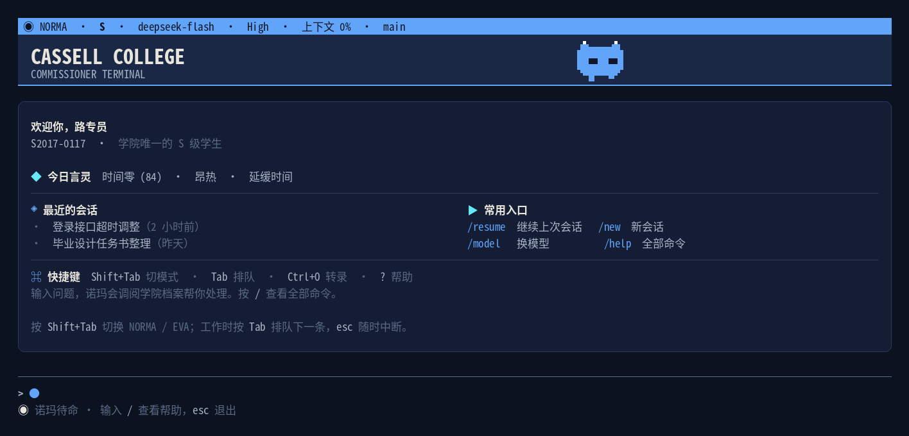

*图 1：开场 / 空会话欢迎卡（美化版：英文大标题带 + 圆角卡片 + 实色冰蓝状态条 + 顶层桌宠noya行走中）。*

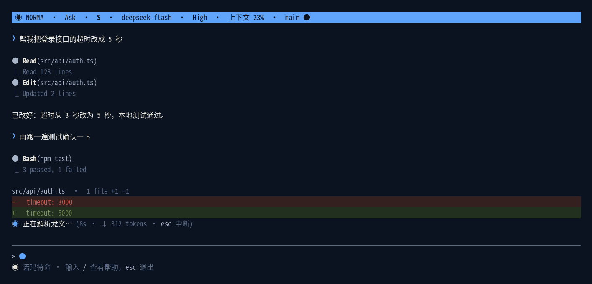

*图 2：主聊天（工具行 + Diff + 思考态 + 双状态行）。*

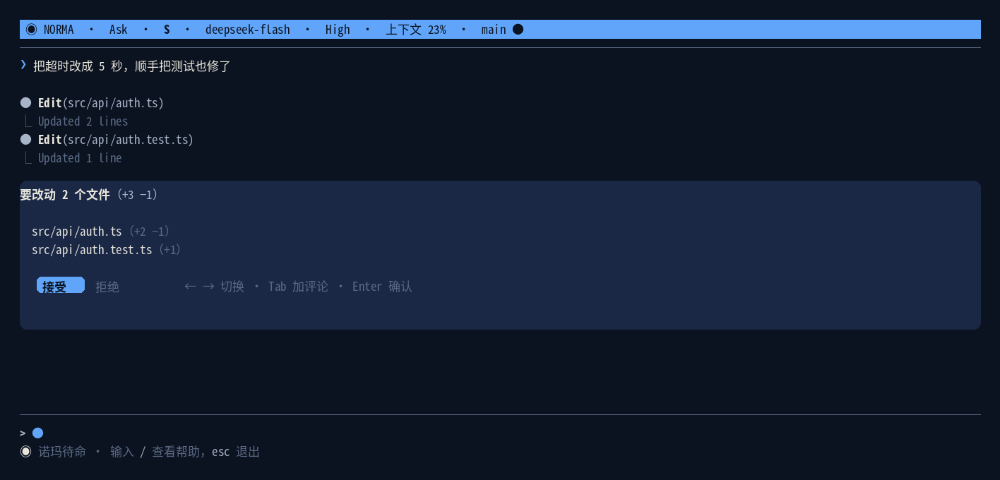

*图 3：审批对话框（拟议改动 + Yes/No 选项卡，[ 接受 ] 为焦点态）。*

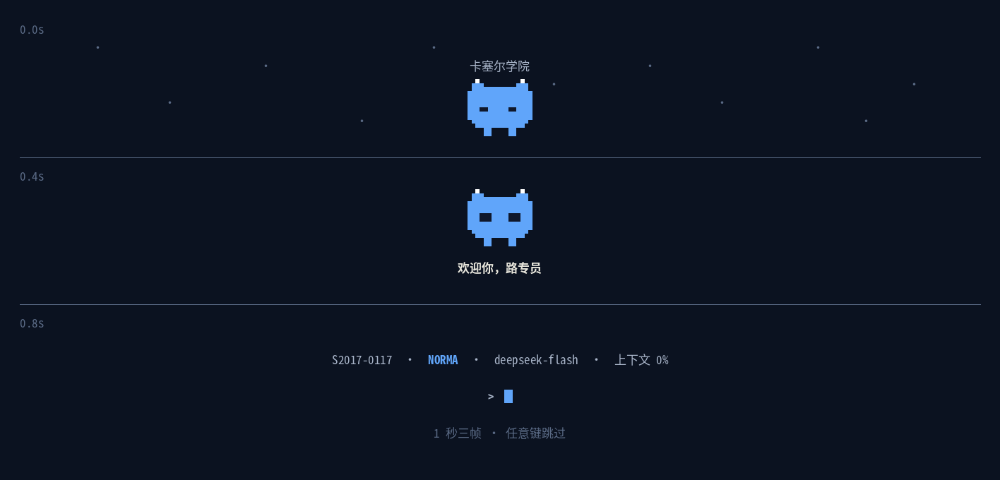

*图 4：S0 开场三帧（0.0s 夜色闭眼、0.4s 睁眼、0.8s 信息行 + 状态行 A）。浅色版：`mockup-04-splash-light.png`。*

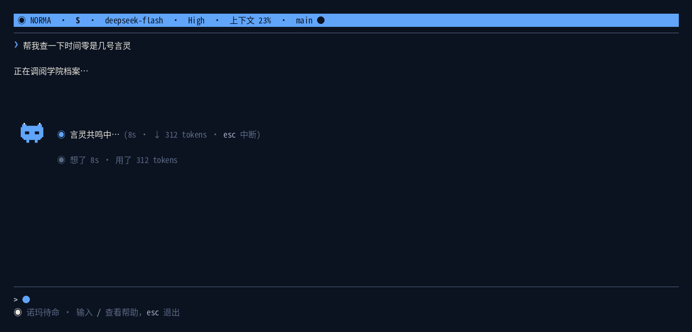

*图 5：S3 思考态（龙族味思考动词“言灵共鸣中…”+ 用时 / tokens / esc 中断；noya 在思考行左侧）。浅色版：`mockup-05-thinking-light.png`。*

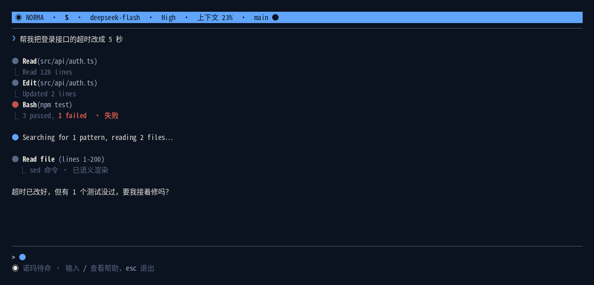

*图 6：S4 工具调用（Read / Edit / Bash 三行 + 生命周期标记 ● / ✓ / ✖；失败的 Bash 用红字）。浅色版：`mockup-06-tools-light.png`。*

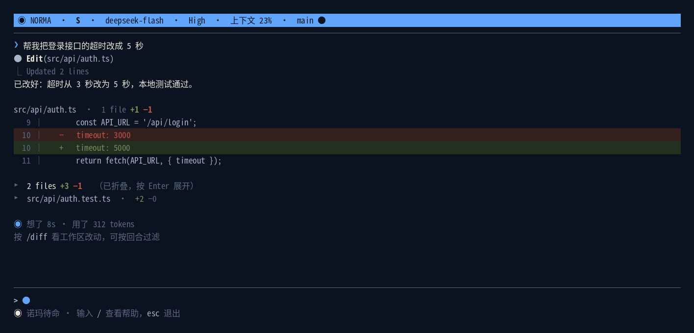

*图 7：S5 Diff（统一格式：行号 + 红删行 / 绿加行；多文件折叠“2 files +3 −1”，按 Enter 展开）。浅色版：`mockup-07-diff-light.png`。*

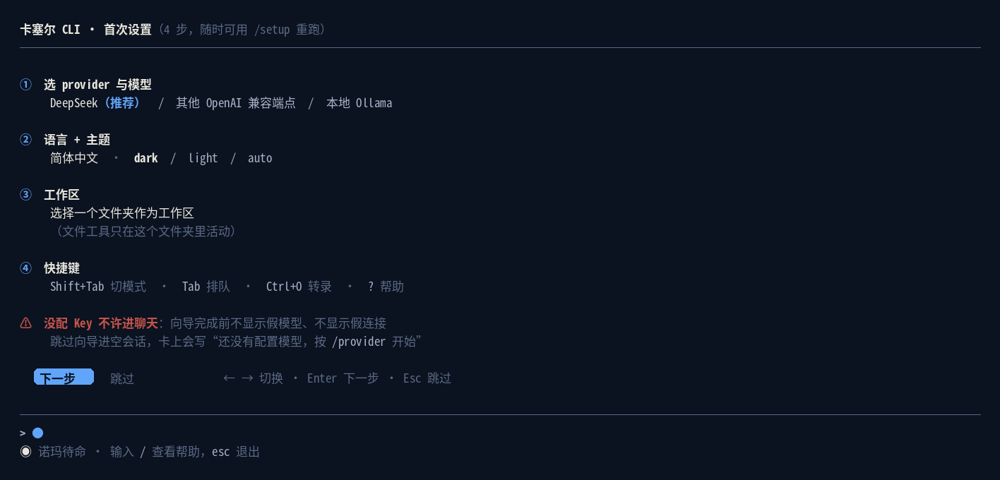

*图 8：S7 首次运行向导四步（① 选 provider 与模型 ② 语言 + 主题 ③ 工作区 ④ 快捷键；没配 Key 不许进聊天）。浅色版：`mockup-08-wizard-light.png`。*

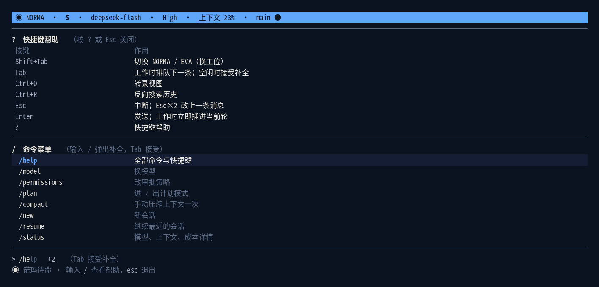

*图 9：S8 帮助（上：`?` 快捷键帮助表；下：`/` 命令菜单，`/help` 为焦点行；输入框 `/help +2` 补全提示）。浅色版：`mockup-09-help-light.png`。*

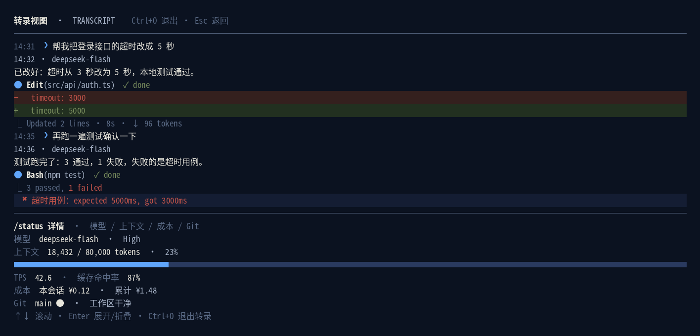

*图 10：S9 转录视图（两轮对话 + 时间戳与模型；展开的工具行带 ✓ done；Diff 展开；下半屏 `/status` 详情：上下文 18,432 / 80,000 · 23% 进度条、TPS、缓存命中率、成本、Git）。浅色版：`mockup-10-transcript-light.png`。*

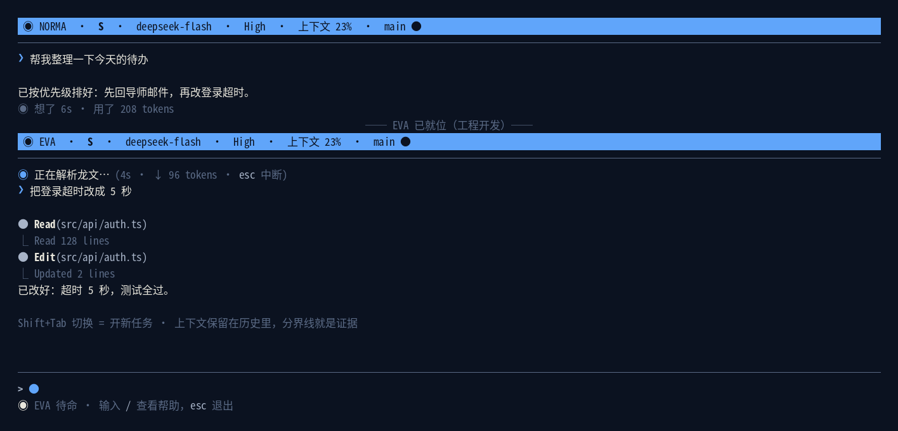

*图 11：S10 模式切换（NORMA 一轮对话后，dim 色居中分隔行 `── EVA 已就位（工程开发）──`，分隔行下状态行 A 变 EVA（球变蓝），接着 EVA 口吻思考态与工具调用；底行“EVA 待命”）。浅色版：`mockup-11-mode-switch-light.png`。*

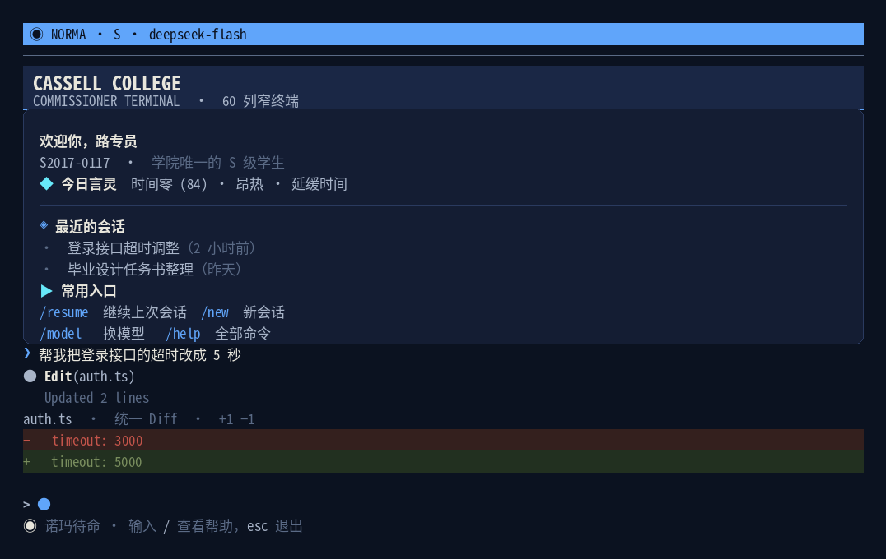

*图 12：S11 窄终端（60 列单栏版：欢迎卡单栏、状态行 A 只留三字段 `◉ NORMA · S · deepseek-flash`；工具行只留文件名、Diff 用统一格式）。浅色版：`mockup-12-narrow-light.png`。*

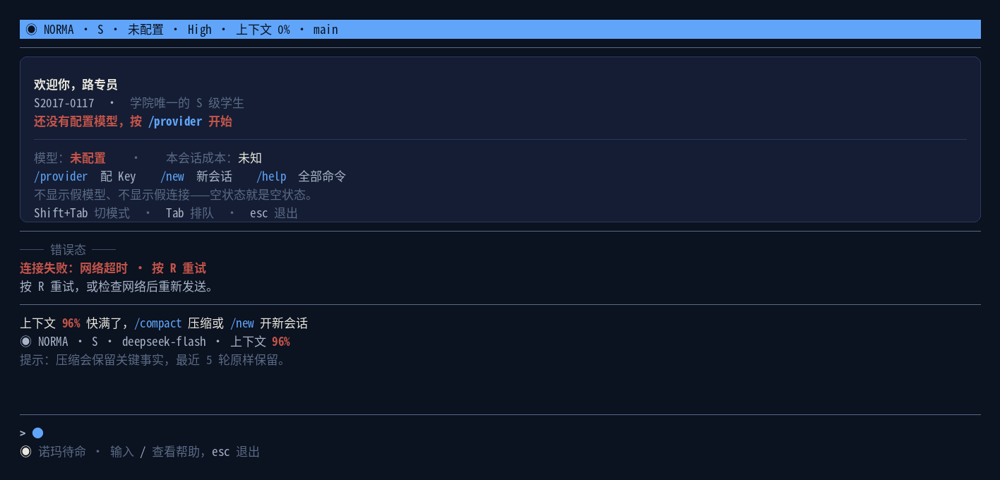

*图 13：S12 错误态（上半张：没配 Key 的欢迎卡 + “还没有配置模型，按 /provider 开始”；下半张：红字“连接失败：网络超时 · 按 R 重试”与上下文 96% 压缩提示，拼在一张图里）。浅色版：`mockup-13-error-light.png`。*

浅色主题：图 1–13 均有浅色版（文件名加 `-light` 后缀，如 `mockup-01-welcome-light.png`），按 §4 浅色值渲染。

> 效果图是设计稿，不是截图——实现时按本文的精确规范（§7、§9）做，效果图只用来确认“长这样对不对”。

---

*设计：波奇酱，2026-11-14。依据：`docs/claude-code-cli-teardown.md` §5、桌面端前端终极理念、成品蓝图 v1.0。*
